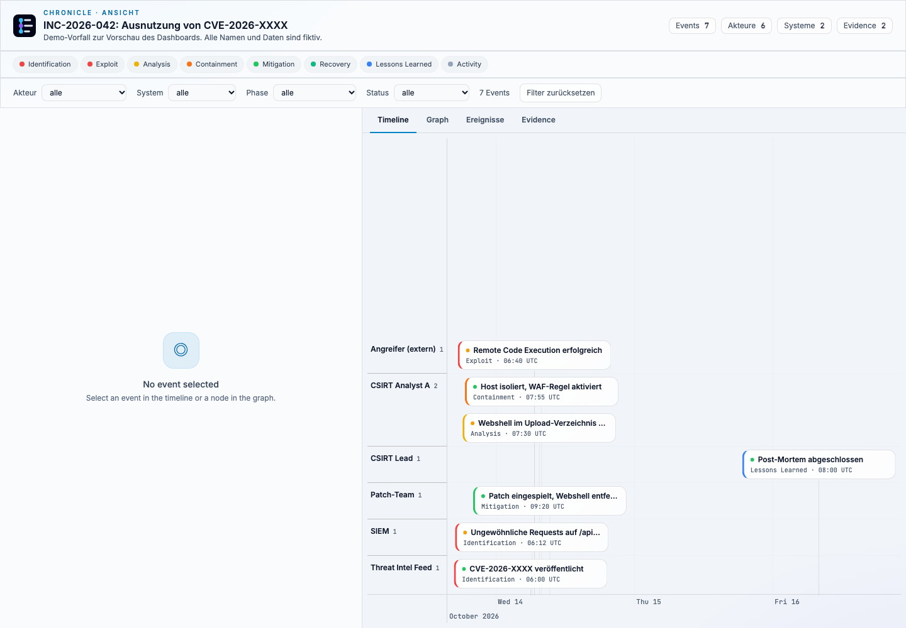

<p align="center">
  
</p>

# Chronicle

Chronicle organizes security knowledge: **events** (with time, actor, system and evidence) belong to **topics** (incidents, vulnerabilities, projects, special events). From them Chronicle builds the timeline, the entity graph and the detail view.



*Dashboard of a topic from the example `data/`, as embedded on the topic page. Fictional demo data.*

> **Status:** in development. Login, roles, user management, editing topics and events in the UI (also directly in the topic files), evidence, reports, API and CLI all work. The interface comes in a light and a dark theme and can be switched between German and English. Open points are tracked in the [issues](https://github.com/JoePhanDro/Chronicle-as-Code/issues).

*Deutsche Version: [README.md](README.md).*

## Contents

- [Quick start with Docker](#quick-start-with-docker)
- [Local without Docker](#local-without-docker)
- [Reports](#reports)
- [Configuration](#configuration)
- [Data format (`timeline.yaml`)](#data-format-timelineyaml)
- [Data storage and editing](#data-storage-and-editing)
- [Interface](#interface)
- [API](#api)
- [Roles and security](#roles-and-security)
- [Project structure](#project-structure)
- [Development and tests](#development-and-tests)
- [Known limitations](#known-limitations)
- [Documentation and contributing](#documentation-and-contributing)

## Quick start with Docker

Requirement: Docker with Compose.

```bash
cp .env.example .env
# Set CHRONICLE_ADMIN_USER and CHRONICLE_ADMIN_PASSWORD in .env (password at least 12 characters).
# Without these values the server prints a one-time code to the log at startup, see below.

docker compose --profile import run --rm importer   # build the index from the topic files in ./data
docker compose up -d                                # start server and HTTPS proxy
```

Then open https://localhost/login. The server is only reachable through the proxy, which enforces HTTPS on port 443 (port 80 redirects). If `certs/cert.pem` and `certs/key.pem` exist, the proxy uses them, otherwise it generates its own self-signed certificate and the browser warns. For a domain with a real certificate see [docs/betrieb-tls.md](docs/betrieb-tls.md).

**Local development without HTTPS:** `docker compose -f docker-compose.yml -f docker-compose.dev.yml up -d` starts only the server on `http://127.0.0.1:8000`, without the proxy.

The topic files in `./data` are the source of truth ([ADR 0011](docs/adr/0011-files-only-write-path.md)): the server writes changes made in the UI into these files. The folder must be writable by user `1000`, which runs the container. If not: `sudo chown -R 1000:1000 data`. On macOS and Windows this is usually not needed. Ideally `data` is under version control (Git), because deleted events can only be recovered through it.

The import builds the index and deliberately does not run on every `up`. It is idempotent, so it can run any number of times, and it is needed when files were changed outside Chronicle (alternatively **Reload** in the UI).

**Migrating from database mode:** if you worked without `--data` and changed events in the UI, those changes exist only in the database. Export them and copy the files into `./data` before switching, otherwise building the index from the old files overwrites the database state:

```bash
mkdir -p export
docker compose run --rm -v "$PWD/export:/export" --entrypoint python api \
  -m chronicle.exporter --db /db/chronicle.db --out /export
```

Tombstones (deleted events of the older version) no longer exist; their tables are removed when the database is first opened. Anything that existed only as a tombstone is lost. Before that, restore and export it with the old version under **Administration, Deleted events**.

**First start without `.env`:** as long as no account exists, the server writes a one-time code to the log at startup:

```bash
docker compose logs api | grep "Einmal-Code"
```

Then open `https://localhost/setup` and enter the code, a username and a password (at least 12 characters). The user becomes admin and is signed in immediately. Afterwards `/setup` is closed. Anyone who cannot read the code from the log cannot create the admin through the UI. The command-line path remains available.

**Create the admin via the command line:**

```bash
docker compose run --rm --entrypoint python api \
  -m chronicle.admin_cli --db /db/chronicle.db create --username admin --role admin
```

## Local without Docker

Requirements: Python 3.12 and Node.js 20 (only for the CSS build).

```bash
npm ci && npm run build:css                 # build the Tailwind CSS
python3 -m venv .venv && source .venv/bin/activate
pip install -r requirements.txt -r requirements-dev.txt

python -m chronicle.admin_cli --db ./chronicle.db create --username admin --role admin
python -m chronicle.importer --db ./chronicle.db --data ./data
CHRONICLE_COOKIE_SECURE=0 python -m chronicle.serve --db ./chronicle.db --data ./data --port 8000
```

`CHRONICLE_COOKIE_SECURE=0` is intended only for tests over HTTP. Without it the server sets the cookie with `Secure`, and browsers still send it back over `http://localhost`.

## Reports

A report is a single HTML file for a topic, e.g. as an attachment to a post-mortem (ADR 0001, ADR 0006). It contains the timeline, graph, event details, the referenced events from other topics and all evidence files embedded. It needs neither server nor login and shows the state at the time of the download.

- **In the app:** admins open **Reports**, pick a topic and download the file. The API endpoint is `GET /api/v1/topics/{key}/report`. Other roles get 403.
- **As PDF** there are two kinds, both readable without graph and login: `technisch` (technical) with all events, details, causes and effects, evidence (images embedded, other files listed), and `management` with key figures and only the event titles with their time. The UI offers both under **Reports**, the API via `GET /api/v1/topics/{key}/report.pdf?art=technisch|management`. Times are in UTC. The PDFs use the built-in fonts, characters outside Latin-1 appear as `?`.

The report is a copy of the data. Whoever has the file sees everything. Share it deliberately and delete it afterwards.

## Configuration

| Variable | Effect | Default |
|---|---|---|
| `CHRONICLE_DB` | Path of the SQLite database for the API | `/data/chronicle.db` |
| `CHRONICLE_ADMIN_USER` | First admin, only when no account exists yet | empty (no bootstrap) |
| `CHRONICLE_ADMIN_PASSWORD` | Password for `CHRONICLE_ADMIN_USER`. The admin must change it at first login | empty |
| `CHRONICLE_COOKIE_SECURE` | `0` switches off the `Secure` flag on the session cookie (only for local HTTP) | `1` |
| `CHRONICLE_TRUSTED_PROXIES` | Addresses or networks of reverse proxies, e.g. `172.18.0.2, 10.0.0.0/8`. Only from there `X-Forwarded-For` is read | empty |
| `CHRONICLE_MAX_BODY_BYTES` | Maximum request body size in bytes. Larger requests get 413 before any part processes them; 0 disables the limit | 112 MiB (10 evidence files plus headroom) |
| `CHRONICLE_SYNC_MAX_GIT_MB` | Maximum size of the `.git` object store in MiB before sync aborts before merging (protection against remotes that fill the data folder) | 512 |
| `CHRONICLE_DATA` | Data folder with the topic files, the source of truth (see below). Required: without it the server does not start. `python -m chronicle.serve --data <folder>` sets it | – |
| `CHRONICLE_WEBHOOK_SECRET` | HMAC-SHA256 secret for signing webhook notifications (`X-Chronicle-Signature: sha256=…`). Without a secret no webhook is sent | empty (webhook disabled) |
| `CHRONICLE_SMTP_HOST` | SMTP server for e-mail notifications. Without a host the e-mail channel stays disabled | empty (e-mail disabled) |
| `CHRONICLE_SMTP_PORT` | SMTP port | `587` |
| `CHRONICLE_SMTP_STARTTLS` | `0` switches STARTTLS off | `1` |
| `CHRONICLE_SMTP_SSL` | `1` for implicit TLS (e.g. port 465) instead of STARTTLS | `0` |
| `CHRONICLE_SMTP_USER` / `CHRONICLE_SMTP_PASSWORD` | Credentials, if the SMTP server requires authentication | empty (no login) |
| `CHRONICLE_SMTP_FROM` | Sender address of notification e-mails | `chronicle@<SMTP host>` |
| `CHRONICLE_SMTP_TIMEOUT` | Timeout for SMTP delivery in seconds | `10` |
| `CHRONICLE_NOTIFY_COOLDOWN_SECONDS` | Rate limit: minimum interval in seconds between two notifications of the same topic, channel and trigger (against spam on import floods). `0` disables | `60` |
| `CHRONICLE_BASE_URL` | Public base URL for links in notification e-mails, e.g. `https://chronicle.example.com` | empty (relative links) |

The values in the Compose stack come from `.env` (template: `.env.example`). `.env` is not versioned.

### Notifications (webhook / e-mail)

Per topic you can configure channels (admin, on the topic page under “Edit”, or in `timeline.yaml` under `topic.notifications`): webhook URL and e-mail recipients, each with the triggers `new_event`, `status_change`, `new_evidence`, `rule_match`. The secrets (webhook signature, SMTP credentials) live only in the environment, never in the topic files that are in Git. The webhook receives the event as JSON, signed with HMAC-SHA256 (`X-Chronicle-Signature`), with 2 retries on timeout/5xx; redirects are not followed. Every delivery, every failure and every rate-limited suppression is logged in the audit log without content (`notification_sent` / `notification_failed` / `notification_suppressed`). See [issue #258](https://github.com/JoePhanDro/Chronicle-as-Code/issues/258).

## Data format (`timeline.yaml`)

One file describes a topic and the events it defines. An example is in `data/timeline.yaml`. The importer reads every `*.yaml` in the data folder, one file per topic. Cross-file references (`triggered_by`, `refs`) are allowed in both directions ([ADR 0005](docs/adr/0005-export-and-backup.md)). Every file is foreign content and is checked before loading: at most 4 MiB and 100,000 nodes, nesting at most 12 levels, no anchors, aliases, tags or duplicate keys (rules in [docs/notation.md](docs/notation.md), section 7). That is enough for more than 1,000 events per file.

```yaml
topic:
  key: inc-2026-042                  # unique, required
  title: "INC-2026-042: …"           # required
  kind: incident                     # incident | vulnerability | project | special | other
  summary: "…"                       # optional

events:
  - key: exploit-2026-10-14          # unique across all topics, required
    t0: 2026-10-14T08:40:00+02:00    # required, with time zone (stored as UTC)
    phase: Exploit                   # Identification | Exploit | Analysis | Containment | Mitigation | Recovery | Lessons Learned
    actor: Attacker (external)
    system: wp-portal-01             # optional
    action: "…"
    status: in_progress              # open | in_progress | resolved
    triggered_by: cve-2026-xxxx      # optional: key of another event
    details: |                       # optional, Markdown
      …
    evidence:                        # optional, paths relative to the file
      - file: evidence/waf-block.png
        type: screenshot             # screenshot | log | report | other
        description: "…"

refs:                                # optional: events defined in another file
  - cve-2026-xxxx
```

- **Home:** every event is defined in exactly one file. Other topics link it via `refs`.
- **Unknown fields** are errors. That prevents silent typos.
- **Evidence** is checked at import and stored in the database. Allowed are PNG, JPEG, GIF, WebP, PDF and UTF-8 text (`.txt`, `.log`), at most 10 MiB per file. Extension and content must match. SVG and HTML are not allowed because browsers execute scripts in them ([ADR 0004](docs/adr/0004-evidence-storage.md)).
- **Colors** follow the phase: red for Identification and Exploit, yellow for Analysis, orange for Containment, green for Mitigation and Recovery, blue for Lessons Learned.

### Checking without a server

`chronicle check` checks a folder of topic files. It needs neither database nor server and writes nothing. It reports all problems at once: schema, duplicate topic and event keys, references, cycles in `triggered_by` and missing attachments.

```bash
python -m chronicle check data                  # check everything, including attachments
python -m chronicle check data --ohne-anhaenge  # without attachments, e.g. in CI
```

The rules are in [docs/notation.md](docs/notation.md). The import checks the same rules before writing.

Editors with YAML support (e.g. VS Code with the “YAML” extension) check and complete the fields using the JSON schema. Exported files and the example dataset already contain the reference. `python -m chronicle schema` prints the schema; the copy in the repo is [schema/timeline.schema.json](schema/timeline.schema.json).

### Writing the index

`chronicle apply` writes the state from the files into the database the app reads. It is repeatable: a second run without changes writes nothing and does not bump versions. Check and write run in one transaction; on an error the database stays unchanged.

```bash
python -m chronicle apply data --db chronicle.db
```

The measurement for index and topic pages is in [scripts/measure_index.py](scripts/measure_index.py).

### Static pages

`chronicle build` writes one standalone HTML page per topic and an `index.html` into a folder. The pages contain stylesheet and attachments themselves, so they need no server. They are marked as a snapshot built from the database, like the report, and contain confidential content. The output is reproducible: the same folder yields the same files.

```bash
npm run build:css                                # once, creates the stylesheet
python -m chronicle build data --out site
```

## Data storage and editing

**Data folder (`--data` or `CHRONICLE_DATA`, required):** the topic files are the source of truth ([ADR 0008](docs/adr/0008-files-as-source-of-truth.md)). An edit in the UI or via the API changes only the affected fields of the file; comments, order and layout are preserved. Afterwards the index is rebuilt from the files. If someone changed the file outside Chronicle, saving fails with a conflict until `chronicle apply` has been run.

- **Topics:** a new topic gets its own file (`tp-<date>-<random>.yaml`) and a key assigned by the server. The key is not entered and never changes.
- **Events:** a new event is appended to the end of its topic's file; the server assigns the key too (`ev-<date>-<random>`). A deleted event disappears from the file and there is no tombstone: the history comes from Git. An event that triggers another cannot be deleted while the reference exists.
- **Links** between topics live under `refs` in the other topic's file. Assigning an event to another topic adds a line there; removing the assignment removes it. When an event is deleted, its references are removed from the other topic files first.
- **Deleting a topic:** this deletes the topic's file including all events whose home topic it is. Events of other topics that are only linked stay, only their reference disappears. If an event of another topic depends on one of the deleted events (`triggered_by`), nothing is deleted, and the page names the events where the reference must be removed first. The attachments stay in the `evidence/` folder.
- **Attachments** are files under `evidence/<event-key>/` in the data folder. The topic file names path, type and description. Same names with different content get a number; nothing is overwritten. An attachment already on the event is not added twice. The `evidence/` folder belongs in synchronization (e.g. OneDrive), not in Git (ADR 0008).
- **Reload:** anyone who changes files by hand or through a Git pull presses **Reload** in the header as analyst or admin (in the “Account” menu on mobile). Chronicle then re-reads the folder. If a file is invalid, the previous state remains and the page names the error.
- **Sync:** several copies of the data folder share a Git remote. Under **Data › Sync** (analyst, admin) Chronicle first shows what changed compared to the remote. A click on **Sync** commits the topic files, takes the remote's state and uploads. Setup: the data folder must be the root of its own Git repository (`git init`, then `git remote add origin <URL>`) and be on a branch. Access to the remote (SSH key or stored credentials) must work without prompting, because the server cannot type anything. A remote that does not answer within 120 seconds aborts the sync; locally everything is kept. Attachments (`evidence/`) are not part of it.
  - Changes to different fields are merged by a merge driver automatically. Comments of your own file stay; comments only the other side has are lost.
  - If both sides changed the same field, the sync aborts and nothing is uploaded. The page shows both states per file with the differing lines. Per file you choose **Keep this copy** or **Take the remote side**; the chosen file fully replaces the other. Afterwards it is checked and uploaded. Every run is in the audit log (`sync`), a resolution with the chosen sides.

**Further rules:**

- Every change bumps the version of an event. Saving on an outdated version gets `409` and you must reload.
- An event that triggers another cannot be deleted while the reference exists.
- Evidence is served only via `GET /api/v1/evidence/{id}`, and only to signed-in users. Files can be uploaded and removed by analyst and admin in the UI or via the API.

The server does not start without a data folder. Operating with the database as the source no longer exists ([ADR 0011](docs/adr/0011-files-only-write-path.md)). If you come from there, export with the old version, see the migration in the quick start.

### Export and backup

Two commands, for different purposes:

- **Export** writes every topic as YAML in the import format, evidence next to it. The files can be imported into an empty database and produce the same export there. Accounts, sessions and the audit log are not included.
- **Backup** copies the index and the operations file (`chronicle.ops.db` next to `chronicle.db`) consistently, even while the service runs. The operations file contains password hashes, sessions and the audit log and cannot be reconstructed from the files. The index, on the other hand, can be rebuilt from the topic files. Both copies are readable only by their owner and must be secured accordingly.

```bash
mkdir -p export backup
docker compose run --rm -v "$PWD/export:/export" --entrypoint python api \
  -m chronicle.exporter --db /db/chronicle.db --out /export
docker compose run --rm -v "$PWD/backup:/backup" --entrypoint python api \
  -m chronicle.backup --db /db/chronicle.db --out /backup
```

The `export` and `backup` folders must be writable by user `1000`, which runs the container. If not: `sudo chown 1000:1000 export backup`.

**Restore** from a backup, only with the service stopped:

```bash
docker compose stop api
docker compose run --rm -v "$PWD/backup:/backup:ro" --entrypoint python api -c \
  "import shutil; shutil.copyfile('/backup/chronicle-JJJJMMTT-HHMMSS.db', '/db/chronicle.db')"
docker compose up -d
```

Replace the file name with the desired backup. The export is not a substitute for a backup. It provides content in readable form, not accounts or logs.

## Interface

The interface is server-rendered; forms are protected with a session CSRF token. Theme (light, dark or as the operating system), display time zone (UTC or browser local time), table density and language (German/English) are set under **Settings**. They apply per browser. Phase names, evidence types, timeline and graph stay English, as in the data model.

| Path | Who | Content |
|---|---|---|
| `/login` | everyone | sign in with username and password |
| `/setup` | while no account exists | create the first admin with the one-time code from the server log |
| `/account/password` | signed in | change own password. Anyone who must change their password lands here |
| `/` | signed in | home page |
| `/events` | signed in | all events, time-sorted and paged. With `?topic=<key>` only the events of a topic (home and linked), with `?system=<name>` or `?actor=<name>` only those of a system or actor |
| `/suche` | signed in | search in events, actors and systems, as separate hits. From the header or with `/` |
| `/hilfe` | signed in | keyboard shortcuts and explanation of the settings |
| `/topics` | signed in | all topics: open first, then by newest event. Shows status, phase of the newest event and event count. From six topics on there is a filter by text and status |
| `/topics/new` | analyst, admin | create a topic (title, kind, summary). The server assigns the key |
| `/topics/{key}` | signed in | topic with status and its events (each with phase color and status), below it the dashboard as an embedded view. Analyst and admin edit the topic, link and unlink events, close all open home events with one button (the topic has no own status, it follows the events) and delete the topic with its home events |
| `/topics/{key}/dashboard` | signed in | dashboard of the topic: timeline, entity graph and details (the view on `/topics/{key}` loads it as a frame) |
| `/events/new` | analyst, admin | create an event. The time is entered in a selectable zone; the line below shows what that is in UTC |
| `/events/{key}` | signed in | details with phase and status, description (Markdown, also Mermaid diagrams), causes and effects, evidence with preview, topics. Analyst and admin change phase and status directly via the two selects in the header, edit the other fields in the “Edit more fields” section, upload evidence and delete the event |
| `/reports` | admin | topics with download of the HTML report and the PDFs |
| `/admin/users` | admin | create accounts, change role and status, set password, lift lock |
| `/admin/audit` | admin | audit log, filterable by action, user and date |

Mermaid diagrams in event descriptions are drawn in the browser. The library loads from a CDN, and only when a diagram is on the page. The diagrams take the colors of the selected theme.

## API

All paths are under `/api/v1`. Write requests need the header `X-CSRF-Token` with the value from `GET /api/v1/auth/me`.

There are no docs pages (`/docs`, `/redoc`, `/openapi.json`): they load scripts from a CDN and expose the complete route map (issue #261). The schema is in the repo at `schema/timeline.schema.json`.

| Method | Path | Role | Content |
|---|---|---|---|
| GET | `/health` | public | only `{"status": "ok"}` — no version, this is public (issue #261) |
| GET | `/admin/version` | admin | running version |
| POST | `/auth/login` | public | JSON `{username, password}`, sets the session cookie |
| POST | `/auth/logout` | signed in | ends the session |
| POST | `/auth/password` | signed in | change own password, JSON `{current_password, new_password}`, ends other sessions |
| GET | `/auth/me` | signed in | own account and CSRF token |
| GET | `/topics` | signed in | all topics with event count |
| GET | `/topics/{key}` | signed in | one topic |
| GET | `/topics/{key}/events` | signed in | events of a topic, time-sorted |
| GET | `/events` | signed in | all events, optional `?topic=<key>` |
| GET | `/events/{key}` | signed in | one event with evidence metadata and topics |
| POST | `/topics` | analyst, admin | create a topic (`title`, `kind`, `summary`). `key` is optional; without it the server assigns one (`tp-<date>-<random>`) |
| PUT | `/topics/{key}` | analyst, admin | change title, kind or summary. The key stays |
| DELETE | `/topics/{key}` | analyst, admin | delete the topic with its home events (409 if events of other topics depend on those events) |
| POST | `/topics/{key}/events` | analyst, admin | link an event to the topic (JSON `{event}`) |
| DELETE | `/topics/{key}/events/{event_key}` | analyst, admin | unlink. The home topic of an event cannot be unlinked (422) |
| POST | `/events` | analyst, admin | create an event (`topic` = home, `topics` = others). `key` is optional; without it the server assigns one (`ev-<date>-<random>`). No evidence in the body, see below |
| PUT | `/events/{key}` | analyst, admin | change an event, body with `version` (otherwise 409) |
| DELETE | `/events/{key}` | analyst, admin | delete an event (409 while another event references it) |
| POST | `/events/{key}/evidence` | analyst, admin | upload a file, multipart with `file`, `type`, `description` |
| GET | `/evidence/{id}` | signed in | content of an evidence file |
| GET | `/topics/{key}/report` | admin | HTML report of the topic as download |
| GET | `/topics/{key}/report.pdf?art=` | admin | PDF report, `technisch` (default) or `management` |
| DELETE | `/evidence/{id}` | analyst, admin | remove evidence |
| GET | `/users` | admin | accounts |
| POST | `/users` | admin | create an account |
| PATCH | `/users/{id}` | admin | change role, activation or password. A new password must be changed by the user at next login |
| POST | `/users/{id}/unlock` | admin | lift the login lock of an account for all addresses |
| GET | `/audit` | admin | log, optional `?action=`, `?actor=`, `?since=` (Unix seconds) |

Responses are JSON. There is no interactive API description yet.

## Roles and security

| Role | May |
|---|---|
| `viewer` | read |
| `analyst` | read, create/change/delete topics and events, link events, upload and remove evidence |
| `admin` | everything, plus users, audit log, reports and the lock password |

- Passwords hashed with Argon2id, minimum length 12 characters.
- **Lock (reading without an account):** an admin sets a lock password under “Settings”. Then visitors without an account can only read after entering this password on the login page. The server serves no data before that. Changing still requires an account with role `analyst` or `admin`. Unlocking applies per browser; changing the password or removing the lock ends all unlocks ([ADR 0007](docs/adr/0007-reading-lock.md)).
- Session via a random cookie (`HttpOnly`, `SameSite=Strict`, `Secure`). Only the SHA-256 hash is stored in the database. Lifetime 8 hours.
- After 5 failed attempts within 15 minutes, login locks the account and IP address together. After 20 failed attempts it locks the IP address for all accounts. A single account is never locked. Counters outside the window are deleted on the next write, so anonymous traffic cannot grow the operations database without bound. Behind a reverse proxy set `CHRONICLE_TRUSTED_PROXIES` so the real address counts ([issue #27](https://github.com/JoePhanDro/Chronicle-as-Code/issues/27)).
- Changing role or password and deactivating end the account's sessions.
- An assigned password (bootstrap admin, created by an admin or reset) must be changed by the user at next login. Until then only the password change, `me` and logout are allowed.
- When changing, the current session stays, all other sessions of the account end.
- The last active admin cannot be demoted or deactivated.
- Every login, every failed attempt and every change to accounts or events lands in the audit log, without content. Attacker-influenced text (e.g. of the login) is capped and the table keeps only the last 100,000 entries; the action itself stays fully visible.
- Both SQLite files (index and operations data) are created with owner-only permissions (0600). The default stack provides no API documentation (no `/docs`, `/redoc`, `/openapi.json`).

The default stack has no TLS and binds only to `127.0.0.1`. For operation in a network there is a Caddy proxy with HTTPS, described in [docs/betrieb-tls.md](docs/betrieb-tls.md) ([issue #35](https://github.com/JoePhanDro/Chronicle-as-Code/issues/35)).

## Project structure

```
chronicle/
  api.py             HTTP app: assembles pages and routers, bootstrap admin, one-time code for /setup
  api_routes/        JSON API under /api/v1, one router per area: topics, events, sync, admin
  pages.py           UI: assembles the routers of page_routes/
  page_routes/       pages and forms, one router per area: events, topics, reports, general (search, help, reload)
  admin_pages.py     administration: accounts, lock, audit log
  administration.py  rules for accounts and locks, shared by API and administration
  auth.py            login, session, CSRF, roles
  reading_lock.py    read lock with password for visitors without an account
  accounts.py        accounts, sessions, throttling, audit log (operations file)
  security.py        password hashing, tokens
  repository.py      entry point for data operations, brings the following modules together
  queries.py         read queries on the index (events, topics, evidence, filters)
  index.py           build the index from the topic files (import, reload)
  folder_writes.py   shared write helpers: lock, rollback, reference lines
  events.py          create, change, delete events
  topics.py          create, change, delete topics, link events
  evidence_store.py  add and remove attachments
  errors.py          error classes of the repository
  store.py           targeted changes in the topic files (file mode)
  event_input.py     input model for writes, keys and time values
  db.py              SQLite schema and migration
  models.py          pydantic schema of the YAML (strict)
  loader.py          discovery, validation and evidence check of the YAML
  yamlscan.py        reading foreign YAML with limits (size, depth, no aliases)
  check.py           chronicle check: check a folder, writes nothing
  importer.py        build the index from the topic files (command `chronicle.importer`, like **Reload**)
  exporter.py        export the database as YAML files per topic
  backup.py          consistent copy of the database
  sync.py, merge.py  sync with the Git remote and merge driver for topic files
  build.py           chronicle build: static pages
  schema.py          JSON schema of the topic files
  evidence.py        allowed files, names, delivery
  markdown.py        Markdown of the event description, sanitized
  renderer.py        dashboard view as HTML, basis of the reports
  report.py          report for a topic from the database
  pdf_report.py      PDF reports (technical, management summary)
  cli.py, __main__.py  chronicle check | apply | build | schema
  serve.py           start the API with uvicorn
  admin_cli.py       manage accounts via the command line
  templates/         Jinja2 templates for UI and dashboard
  static/            input.css (source), app.css (built, not versioned), diagrams.js (Mermaid)
  static/vendor/     vis-timeline and vis-network, shipped unchanged (provenance in the README there)
data/                example YAML and placeholder evidence
docs/                ADRs, notation of the topic files, TLS operation
tests/               pytest; tests/ui/ are browser tests
PRODUCT.md           product context (users, purpose, principles)
DESIGN.md            design system (colors, typography, light and dark, components)
```

## Development and tests

```bash
npm ci && npm run build:css      # after every template change with new Tailwind classes
ruff check .                     # lint
pytest                           # tests (requirements-dev.txt)
coverage run --source=chronicle -m pytest -q && coverage report   # coverage
pytest -m browser                # browser tests (once: python -m playwright install chromium)
```

The CI runs on every pull request: lint and tests with a render run of the dashboard and JavaScript syntax check (“Tests & smoke build”), browser tests, Docker build with API container start and health check, the Caddy proxy check and `chronicle check` on the example data. A merge is done by hand and only with green checks (see [CONTRIBUTING.md](CONTRIBUTING.md)).

## Known limitations

The most important open points:

- A report serves a topic without login once you have the file. It is a snapshot, not a live state ([#24](https://github.com/JoePhanDro/Chronicle-as-Code/issues/24)).
- Mermaid diagrams need CDN access when displayed. Reports and static pages are therefore almost, but not fully, usable offline.
- In file mode, attachments stay in the `evidence/` folder when an event or topic is deleted, and there is no restore in the UI. The previous version of the topic file comes from Git.

Full list: [issues](https://github.com/JoePhanDro/Chronicle-as-Code/issues).

## Documentation and contributing

- Architecture decisions: [`docs/adr/`](docs/adr/)
  - [ADR 0001](docs/adr/0001-backend-auth-pages.md): server, login, pages (accepted)
  - [ADR 0002](docs/adr/0002-topics-and-events.md): events and topics (to be confirmed)
  - [ADR 0003](docs/adr/0003-editing-in-the-ui.md): editing in the UI (superseded by ADR 0008 and ADR 0011)
  - [ADR 0004](docs/adr/0004-evidence-storage.md): evidence in the database, deviation from ADR 0001 (to be confirmed)
  - [ADR 0005](docs/adr/0005-export-and-backup.md): YAML export, backup and import of several topic files (to be confirmed)
  - [ADR 0006](docs/adr/0006-reports-from-the-app.md): reports from the database, admins only (to be confirmed)
  - [ADR 0007](docs/adr/0007-reading-lock.md): read lock with password (accepted)
  - [ADR 0008](docs/adr/0008-files-as-source-of-truth.md): files as the source of truth (accepted)
  - [ADR 0009](docs/adr/0009-cli-first.md): CLI as core product, server as interface (accepted for the CLI part)
  - [ADR 0010](docs/adr/0010-operations-separate.md): operations data separate from the index (accepted)
  - [ADR 0011](docs/adr/0011-files-only-write-path.md): files are the only write path (accepted, implemented)
  - [ADR 0012](docs/adr/0012-code-repo-und-vault-repos.md): code repository and vault repositories (proposal, [architecture](docs/architecture/vault-git.md))
  - [ADR 0013](docs/adr/0013-vault-layout-und-format.md): vault layout and format (proposal, [architecture](docs/architecture/vault-git.md))
  - [ADR 0014](docs/adr/0014-lokale-konfiguration-und-login.md): local configuration and login (proposal, [architecture](docs/architecture/vault-git.md))
  - [ADR 0015](docs/adr/0015-identitaet-und-autorenschaft.md): identity and authorship (proposal, [architecture](docs/architecture/vault-git.md))
  - [ADR 0016](docs/adr/0016-freigabe-workflow.md): sharing workflow (proposal, [architecture](docs/architecture/vault-git.md))
  - [ADR 0017](docs/adr/0017-konflikte-und-merge.md): conflicts and merge (proposal, [architecture](docs/architecture/vault-git.md))
  - [ADR 0018](docs/adr/0018-index-als-abgeleiteter-zustand.md): index as derived state (proposal, [architecture](docs/architecture/vault-git.md))
  - [ADR 0019](docs/adr/0019-mehrere-vaults-und-mandantentrennung.md): several vaults and tenant separation (proposal, [architecture](docs/architecture/vault-git.md))
  - [ADR 0020](docs/adr/0020-anhaenge-im-vault.md): attachments in the vault (owner decision: in Git, large files via link) (proposal, [architecture](docs/architecture/vault-git.md))
  - [ADR 0021](docs/adr/0021-sensible-daten-und-loeschkonzept.md): sensitive data and deletion concept (proposal, [architecture](docs/architecture/vault-git.md))
  - [ADR 0022](docs/adr/0022-git-integration-und-eingabepruefung.md): Git integration and input validation (proposal, [architecture](docs/architecture/vault-git.md))
  - [ADR 0023](docs/adr/0023-migration-und-formatversionen.md): migration and format versions (proposal, [architecture](docs/architecture/vault-git.md))
  - [ADR 0024](docs/adr/0024-verschluesselung-der-eintraege.md): encryption of entries (decision: not for now, out of scope, [architecture](docs/architecture/vault-git.md))
  - [ADR 0025](docs/adr/0025-zeitraeume-und-entdeckungszeit.md): time ranges and detection time on events (proposal, [issue #208](https://github.com/JoePhanDro/Chronicle-as-Code/issues/208))
  - [ADR 0026](docs/adr/0026-mitre-attack-zuordnung.md): MITRE ATT&CK mapping on events (proposal, [issue #209](https://github.com/JoePhanDro/Chronicle-as-Code/issues/209))
- Notation of the topic files: [`docs/notation.md`](docs/notation.md). Product context and design system: [`PRODUCT.md`](PRODUCT.md) and [`DESIGN.md`](DESIGN.md).
- How to contribute: [CONTRIBUTING.md](CONTRIBUTING.md).

The example data in `data/` is fictional. The evidence PNGs in `data/evidence/` are placeholders rendered from SVG templates, not real screenshots. `docs/screenshots/dashboard.png` shows the dashboard with this demo data.
