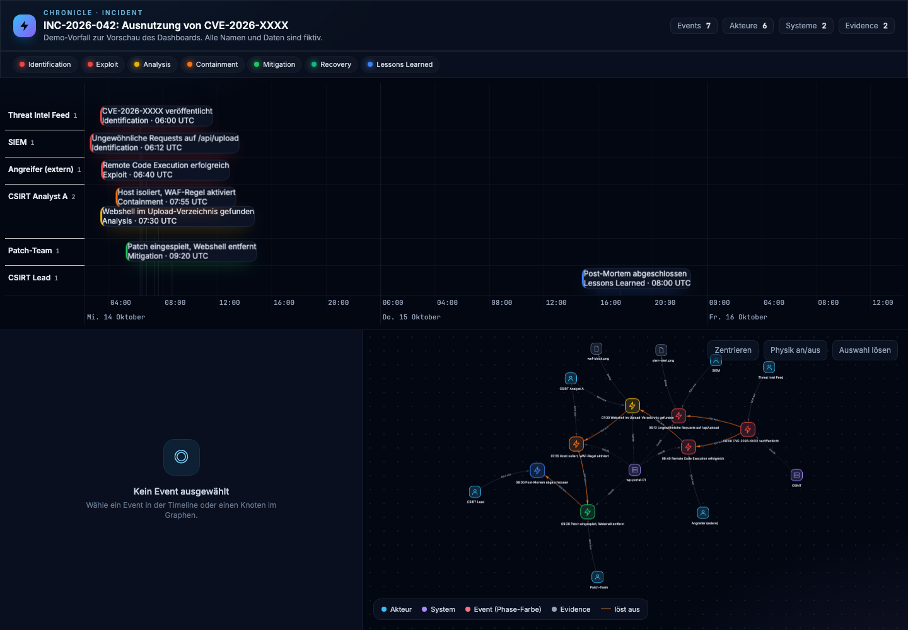

# Chronicle

Chronicle organisiert Sicherheitswissen: **Events** (Ereignisse mit Zeitpunkt, Akteur, System und Belegen) gehören zu **Topics** (Incidents, Schwachstellen, Projekte, besondere Ereignisse). Daraus entstehen Timeline, Entitäten-Graph und Detailansicht.



*Dashboard eines Topics aus dem Beispiel `data/`, so wie es auf der Topic-Seite eingebettet ist. Fiktive Demo-Daten.*

> **Status:** Entwicklungsstand. Anmeldung, Rollen, Benutzerverwaltung, Event- und Topic-Pflege in der Oberfläche, Evidence, Berichte, API und CLI laufen. Timeline, Graph und Detailansicht sind in der Oberfläche auf der Topic-Seite eingebettet. Offene Punkte stehen in den [Issues](https://github.com/JoePhanDro/Chronicle-as-Code/issues).

## Inhalt

- [Schnellstart mit Docker](#schnellstart-mit-docker)
- [Lokal ohne Docker](#lokal-ohne-docker)
- [Konfiguration](#konfiguration)
- [Datenformat (`timeline.yaml`)](#datenformat-timelineyaml)
- [Datenhaltung und Bearbeitung](#datenhaltung-und-bearbeitung)
- [API](#api)
- [Rollen und Sicherheit](#rollen-und-sicherheit)
- [Projektstruktur](#projektstruktur)
- [Entwicklung und Tests](#entwicklung-und-tests)
- [Bekannte Einschränkungen](#bekannte-einschränkungen)
- [Dokumentation und Beitragen](#dokumentation-und-beitragen)

## Schnellstart mit Docker

Voraussetzung: Docker mit Compose.

```bash
cp .env.example .env
# In .env CHRONICLE_ADMIN_USER und CHRONICLE_ADMIN_PASSWORD setzen (Passwort mind. 12 Zeichen).
# Ohne diese Werte zeigt der Server beim Start einen Einmal-Code im Log, siehe unten.

docker compose --profile import run --rm importer   # Topic-Datei aus ./data importieren
docker compose up -d api                            # Server starten
```

Dann http://localhost:8000/login öffnen. Der Port ist nur auf `127.0.0.1` gebunden.

Der Import läuft bewusst nicht bei jedem `up`. Er ist idempotent, kann also beliebig oft laufen.

**Erster Start ohne `.env`:** Solange kein Konto existiert, schreibt der Server beim Start einen Einmal-Code ins Log:

```bash
docker compose logs api | grep "Einmal-Code"
```

Dann `http://localhost:8000/setup` öffnen, den Code, einen Benutzernamen und ein Passwort (mindestens 12 Zeichen) eintragen. Der Benutzer wird Admin und ist sofort angemeldet. Danach ist `/setup` geschlossen. Wer den Code nicht aus dem Log lesen kann, kann den Admin nicht über die Oberfläche anlegen. Der Weg über die Kommandozeile bleibt möglich.

**Admin über die Kommandozeile anlegen:**

```bash
docker compose run --rm --entrypoint python api \
  -m chronicle.admin_cli --db /db/chronicle.db create --username admin --role admin
```

## Lokal ohne Docker

Voraussetzungen: Python 3.12 und Node.js 20 (nur für das CSS-Build).

```bash
npm ci && npm run build:css                 # Tailwind-CSS bauen
python3 -m venv .venv && source .venv/bin/activate
pip install -r requirements.txt -r requirements-dev.txt

python -m chronicle.admin_cli --db ./chronicle.db create --username admin --role admin
python -m chronicle.importer --db ./chronicle.db --data ./data
CHRONICLE_COOKIE_SECURE=0 python -m chronicle.serve --db ./chronicle.db --port 8000
```

`CHRONICLE_COOKIE_SECURE=0` ist nur für Tests über HTTP gedacht. Ohne diese Variable setzt der Server das Cookie
mit `Secure`, und Browser schicken es über `http://localhost` trotzdem zurück.

## Berichte

Ein Bericht ist eine einzelne HTML-Datei zu einem Topic, etwa als Anhang zu einem Post-Mortem (ADR 0001, ADR 0006). Er enthält Timeline, Graph, Event-Details, die verknüpften Events aus anderen Topics und alle Evidence-Dateien eingebettet. Er braucht weder Server noch Anmeldung und zeigt den Stand zum Zeitpunkt des Downloads.

- **In der Anwendung:** Admins öffnen **Berichte**, wählen ein Topic und laden die Datei. Die API hat dafür `GET /api/v1/topics/{key}/report`. Andere Rollen bekommen 403.

Der Bericht ist eine Kopie der Daten. Wer die Datei hat, sieht alles. Teile sie nur bewusst und lösche sie danach. Der Standard-Entrypoint des Images ist die API.

## Konfiguration

| Variable | Wirkung | Standard |
|---|---|---|
| `CHRONICLE_DB` | Pfad zur SQLite-Datenbank für die API | `/data/chronicle.db` |
| `CHRONICLE_ADMIN_USER` | Erster Admin, nur wenn noch kein Konto existiert | leer (kein Bootstrap) |
| `CHRONICLE_ADMIN_PASSWORD` | Passwort zu `CHRONICLE_ADMIN_USER`. Der Admin muss es beim ersten Login ändern | leer |
| `CHRONICLE_COOKIE_SECURE` | `0` schaltet das `Secure`-Flag am Sitzungscookie ab (nur lokal über HTTP) | `1` |
| `CHRONICLE_TRUSTED_PROXIES` | Adressen oder Netze von Reverse Proxies, z. B. `172.18.0.2, 10.0.0.0/8`. Nur von dort wird `X-Forwarded-For` gelesen | leer |

Die Werte im Compose-Stack kommen aus `.env` (Vorlage: `.env.example`). `.env` wird nicht versioniert.

## Datenformat (`timeline.yaml`)

Eine Datei beschreibt ein Topic und die Events, die es definiert. Ein Beispiel liegt in `data/timeline.yaml`. Der Importer liest jede `*.yaml` im Datenordner, eine Datei je Topic. Verweise zwischen Dateien (`triggered_by`, `refs`) sind in beide Richtungen erlaubt ([ADR 0005](docs/adr/0005-export-and-backup.md)).

```yaml
topic:
  key: inc-2026-042                  # eindeutig, Pflicht
  title: "INC-2026-042: …"           # Pflicht
  kind: incident                     # incident | vulnerability | project | special | other
  summary: "…"                       # optional

events:
  - key: exploit-2026-10-14          # eindeutig über alle Topics, Pflicht
    t0: 2026-10-14T08:40:00+02:00    # Pflicht, mit Zeitzone (gespeichert als UTC)
    phase: Exploit                   # Identification | Exploit | Analysis | Containment | Mitigation | Recovery | Lessons Learned
    actor: Angreifer (extern)
    system: wp-portal-01             # optional
    action: "…"
    status: in_progress              # open | in_progress | resolved
    triggered_by: cve-2026-xxxx      # optional: Key eines anderen Events
    details: |                       # optional, Markdown
      …
    evidence:                        # optional, Pfade relativ zur Datei
      - file: evidence/waf-block.png
        type: screenshot             # screenshot | log | report | other
        description: "…"

refs:                                # optional: Events, die in einer anderen Datei definiert sind
  - cve-2026-xxxx
```

- **Heimat:** Jedes Event wird in genau einer Datei definiert. Andere Topics binden es über `refs` ein.
- **Unbekannte Felder** sind Fehler. Das verhindert stille Tippfehler.
- **Evidence** wird beim Import geprüft und in der Datenbank gespeichert. Erlaubt sind PNG, JPEG, GIF, WebP, PDF und UTF-8-Text (`.txt`, `.log`), höchstens 10 MiB je Datei. Endung und Inhalt müssen zusammenpassen. SVG und HTML sind nicht erlaubt, weil Browser darin Skripte ausführen ([ADR 0004](docs/adr/0004-evidence-storage.md)).
- **Farben** folgen der Phase: rot für Identification und Exploit, gelb für Analysis, orange für Containment, grün für Mitigation und Recovery, blau für Lessons Learned.

### Prüfen ohne Server

`chronicle check` prüft einen Ordner mit Topic-Dateien. Es braucht weder Datenbank noch Server und schreibt nichts. Es meldet alle Probleme auf einmal: Schema, doppelte Topic- und Event-Keys, Verweise, Kreise in `triggered_by` und fehlende Anhänge.

```bash
python -m chronicle check data                  # alles prüfen, inklusive Anhänge
python -m chronicle check data --ohne-anhaenge  # ohne Anhänge, z. B. in der CI
```

Die Regeln stehen in [docs/notation.md](docs/notation.md). Der Import prüft dieselben Regeln, bevor er schreibt.

## Datenhaltung und Bearbeitung

Die Datenbank ist nach dem Import die Quelle der Wahrheit ([ADR 0003](docs/adr/0003-editing-in-the-ui.md)):

- Ein erneuter Import überschreibt keine Events, die in der Oberfläche bearbeitet wurden. Gelöschte Events kehren nicht zurück. Beides meldet der Import.
- Ein Import entfernt keine Topic-Verknüpfungen. Die ändert man in der Oberfläche.
- Jede Änderung erhöht die Version eines Events. Wer auf einer veralteten Fassung speichert, bekommt `409` und muss neu laden.
- Ein Event, das ein anderes auslöst, lässt sich nicht löschen, solange der Verweis besteht.

- Evidence wird nur über `GET /api/v1/evidence/{id}` ausgeliefert, und nur an angemeldete Nutzer. Dateien können Analyst und Admin in der Oberfläche oder über die API hochladen und entfernen. Uploads ändern das Event wie eine Bearbeitung: Ein erneuter Import überschreibt es nicht.

**Nach einem Update** auf diese Version einmal den Import ausführen (`docker compose --profile import run --rm importer`). Evidence, die vorher nur als Pfad vorlag, bekommt dabei seinen Inhalt. Bis dahin antwortet der Download mit 404.

### Export und Backup

Zwei Befehle, mit unterschiedlichem Zweck:

- **Export** schreibt jedes Topic als YAML im Importformat, Evidence daneben. Die Dateien lassen sich mit dem Importer in eine leere Datenbank einspielen und ergeben dort wieder denselben Export. Konten, Sitzungen und das Audit-Log gehören nicht dazu.
- **Backup** kopiert die ganze Datenbank konsistent, auch während der Dienst läuft. Die Kopie enthält Passwort-Hashes, Sitzungen und das Audit-Log. Sie ist nur für den Eigentümer lesbar und gehört entsprechend gesichert.

```bash
mkdir -p export backup
docker compose run --rm -v "$PWD/export:/export" --entrypoint python api \
  -m chronicle.exporter --db /db/chronicle.db --out /export
docker compose run --rm -v "$PWD/backup:/backup" --entrypoint python api \
  -m chronicle.backup --db /db/chronicle.db --out /backup
```

Die Ordner `export` und `backup` müssen für den Benutzer `1000` beschreibbar sein, unter dem der Container läuft. Falls nicht: `sudo chown 1000:1000 export backup`.

**Wiederherstellen** aus einem Backup, nur bei gestopptem Dienst:

```bash
docker compose stop api
docker compose run --rm -v "$PWD/backup:/backup:ro" --entrypoint python api -c \
  "import shutil; shutil.copyfile('/backup/chronicle-JJJJMMTT-HHMMSS.db', '/db/chronicle.db')"
docker compose up -d api
```

Den Dateinamen ersetzt man durch das gewünschte Backup. Der Export ist kein Ersatz für ein Backup. Er stellt Inhalte in lesbarer Form bereit, nicht Konten oder Protokoll.

## Oberfläche

| Pfad | Wer | Inhalt |
|---|---|---|
| `/login` | alle | Anmeldung mit Benutzername und Passwort |
| `/account/password` | angemeldet | eigenes Passwort ändern. Wer ein Passwort ändern muss, landet hier |
| `/` | angemeldet | Startseite |
| `/events` | angemeldet | alle Events, zeitlich sortiert. Mit `?topic=<key>` nur die Events eines Topics (Heimat und verknüpft), mit `?system=<name>` nur die eines Systems |
| `/suche` | angemeldet | Suche in Ereignissen, Akteuren und Systemen, als getrennte Treffer. Aufruf aus der Kopfzeile oder mit `/` |
| `/hilfe` | angemeldet | Tastenkürzel und Erklärung der Einstellungen |
| `/topics` | angemeldet | alle Topics mit Anzahl der Events |
| `/topics/new` | analyst, admin | Topic anlegen (Key, Titel, Art, Zusammenfassung) |
| `/topics/{key}` | angemeldet | Topic und seine Events; bearbeiten, löschen, Events verknüpfen und lösen für analyst und admin. Enthält das Dashboard als eingebettete Ansicht |
| `/topics/{key}/dashboard` | angemeldet | Dashboard des Topics: Timeline, Entitäten-Graph und Details (die Ansicht auf `/topics/{key}` lädt sie als Frame) |
| `/events/new` | analyst, admin | Event anlegen |
| `/events/{key}` | angemeldet | Details, Evidence mit Vorschau, Topics; bearbeiten, Evidence hochladen und löschen für analyst und admin |
| `/reports` | admin | Topics mit Download des HTML-Berichts |
| `/admin/users` | admin | Konten anlegen, Rolle und Status ändern, Passwort setzen, Sperre aufheben |
| `/admin/audit` | admin | Audit-Log, filterbar nach Aktion, Benutzer und Datum |

Die Oberfläche ist serverseitig gerendert. Formulare sind mit einem CSRF-Token der Sitzung geschützt.

## API

Alle Pfade liegen unter `/api/v1`. Schreibende Anfragen brauchen den Header `X-CSRF-Token` mit dem Wert aus `GET /api/v1/auth/me`.

| Methode | Pfad | Rolle | Inhalt |
|---|---|---|---|
| GET | `/health` | öffentlich | Status und Version |
| POST | `/auth/login` | öffentlich | JSON `{username, password}`, setzt Sitzungscookie |
| POST | `/auth/logout` | angemeldet | beendet die Sitzung |
| POST | `/auth/password` | angemeldet | eigenes Passwort ändern, JSON `{current_password, new_password}`, beendet andere Sitzungen |
| GET | `/auth/me` | angemeldet | eigenes Konto und CSRF-Token |
| GET | `/topics` | angemeldet | alle Topics mit Anzahl der Events |
| GET | `/topics/{key}` | angemeldet | ein Topic |
| GET | `/topics/{key}/events` | angemeldet | Events eines Topics, zeitlich sortiert |
| GET | `/events` | angemeldet | alle Events, optional `?topic=<key>` |
| GET | `/events/{key}` | angemeldet | ein Event mit Evidence-Metadaten und Topics |
| POST | `/topics` | analyst, admin | Topic anlegen (`key`, `title`, `kind`, `summary`) |
| PUT | `/topics/{key}` | analyst, admin | Titel, Art oder Zusammenfassung ändern. Der Key bleibt |
| DELETE | `/topics/{key}` | analyst, admin | Topic löschen (409, solange Heimat-Events darin liegen) |
| POST | `/topics/{key}/events` | analyst, admin | Event mit dem Topic verknüpfen (JSON `{event}`) |
| DELETE | `/topics/{key}/events/{event_key}` | analyst, admin | Verknüpfung lösen. Das Heimat-Topic eines Events lässt sich nicht lösen (422) |
| POST | `/events` | analyst, admin | Event anlegen (`topic` = Heimat, `topics` = weitere). `key` ist optional, ohne Key vergibt der Server einen (`ev-<Datum>-<zufällig>`). Evidence im Body gibt es nicht, siehe unten |
| PUT | `/events/{key}` | analyst, admin | Event ändern, Body mit `version` (sonst 409) |
| DELETE | `/events/{key}` | analyst, admin | Event löschen (409, solange ein anderes Event darauf verweist) |
| POST | `/events/{key}/evidence` | analyst, admin | Datei hochladen, multipart mit `file`, `type`, `description` |
| GET | `/evidence/{id}` | angemeldet | Inhalt einer Evidence-Datei |
| GET | `/topics/{key}/report` | admin | HTML-Bericht des Topics als Download |
| DELETE | `/evidence/{id}` | analyst, admin | Evidence entfernen |
| GET | `/users` | admin | Konten |
| POST | `/users` | admin | Konto anlegen |
| PATCH | `/users/{id}` | admin | Rolle, Aktivierung oder Passwort ändern. Ein neues Passwort muss der Nutzer beim nächsten Login ändern |
| POST | `/users/{id}/unlock` | admin | Login-Sperre eines Kontos für alle Adressen aufheben |
| GET | `/audit` | admin | Protokoll, optional `?action=`, `?actor=`, `?since=` (Unix-Sekunden) |

Die Antworten sind JSON. Eine interaktive Beschreibung der API gibt es noch nicht.

## Rollen und Sicherheit

| Rolle | Darf |
|---|---|
| `viewer` | lesen |
| `analyst` | lesen, Events anlegen, ändern, löschen |
| `admin` | alles, plus Benutzer und Audit-Log |

- Passwörter mit Argon2id gehasht, Mindestlänge 12 Zeichen.
- **Sperre (Lesen ohne Konto):** Ein Admin setzt unter „Einstellungen“ ein Sperr-Passwort. Dann lesen Besucher ohne Konto nur nach Eingabe dieses Passworts auf der Anmeldeseite. Der Server liefert vorher keine Daten aus. Ändern dürfen weiter nur Konten mit Rolle `analyst` oder `admin`. Entsperren gilt pro Browser, Passwort ändern oder Sperre aufheben beendet alle Entsperrungen ([ADR 0007](docs/adr/0007-reading-lock.md)).
- Sitzung über ein zufälliges Cookie (`HttpOnly`, `SameSite=Strict`, `Secure`). In der Datenbank liegt nur der SHA-256-Hash. Laufzeit 8 Stunden.
- Nach 5 Fehlversuchen innerhalb von 15 Minuten sperrt die Anmeldung Konto und IP-Adresse gemeinsam. Nach 20 Fehlversuchen sperrt sie die IP-Adresse für alle Konten. Ein Konto allein wird nie gesperrt. Hinter einem Reverse Proxy setzt man `CHRONICLE_TRUSTED_PROXIES`, damit die echte Adresse zählt ([Issue #27](https://github.com/JoePhanDro/Chronicle-as-Code/issues/27)).
- Ändern von Rolle oder Passwort und Deaktivieren beenden die Sitzungen des Kontos.
- Ein vergebenes Passwort (Bootstrap-Admin, durch einen Admin angelegt oder zurückgesetzt) muss der Nutzer beim nächsten Login ändern. Bis dahin sind nur der Passwortwechsel, `me` und Logout erlaubt.
- Beim Wechsel bleibt die aktuelle Sitzung bestehen, alle anderen Sitzungen des Kontos enden.
- Der letzte aktive Admin lässt sich nicht herabstufen oder deaktivieren.
- Jeder Login, jeder Fehlversuch und jede Änderung an Konten oder Events landet im Audit-Log, ohne Inhalte.

Der Standard-Stack hat kein TLS und bindet nur auf `127.0.0.1`. Für einen Betrieb im Netzwerk gibt es einen Caddy-Proxy mit HTTPS, beschrieben in [docs/betrieb-tls.md](docs/betrieb-tls.md) ([Issue #35](https://github.com/JoePhanDro/Chronicle-as-Code/issues/35)).

## Projektstruktur

```
chronicle/
  api.py           HTTP-App: API, Routen für Benutzer und Audit, Bootstrap-Admin
  pages.py         Oberfläche: Events anlegen, bearbeiten, löschen (Formulare)
  auth.py          Anmeldung, Sitzung, CSRF, Rollen
  accounts.py      Konten, Sitzungen, Drosselung, Audit-Log (Datenbank)
  security.py      Passwort-Hashing, Token
  repository.py    Topics und Events: Import und Schreibzugriffe
  event_input.py   Eingabemodell für Schreibzugriffe (gleiche Regeln wie der Import)
  db.py            SQLite-Schema und Migration
  importer.py      YAML in die Datenbank importieren
  exporter.py      Datenbank als YAML-Dateien je Topic exportieren
  backup.py        konsistente Kopie der Datenbank
  serve.py         API mit uvicorn starten
  admin_cli.py     Konten über die Kommandozeile verwalten
  models.py        Pydantic-Schema der YAML (strikt)
  loader.py        Suche, Validierung und Evidence-Prüfung der YAML
  renderer.py      Dashboard-Ansicht als HTML, Grundlage der Berichte
  report.py        Bericht zu einem Topic aus der Datenbank
  templates/       Jinja2-Vorlagen für Oberfläche und Dashboard
  static/          input.css (Quelle) und app.css (gebaut, nicht versioniert)
data/              Beispiel-YAML und Platzhalter-Evidence
docs/adr/          Architekturentscheidungen
tests/             pytest
```

## Entwicklung und Tests

```bash
npm ci && npm run build:css      # nach jeder Template-Änderung mit neuen Tailwind-Klassen
pytest                           # Tests (requirements-dev.txt)
```

Die CI läuft bei jeder Pull-Request: Tests, Render-Lauf des Dashboards aus den Beispieldaten, JavaScript-Syntaxprüfung, Docker-Build und Start des API-Containers mit Health-Check. Ein Merge ist nur möglich, wenn beide Checks grün sind.

## Bekannte Einschränkungen

Die wichtigsten offenen Punkte, mit Issue-Nummern:

- Ein Bericht liefert ein Topic ohne Anmeldung, sobald man die Datei hat. Er ist ein Snapshot und kein Live-Stand ([#24](https://github.com/JoePhanDro/Chronicle-as-Code/issues/24))
- Keine Suche und keine Paginierung ([#30](https://github.com/JoePhanDro/Chronicle-as-Code/issues/30))

Vollständige Liste: [Issues](https://github.com/JoePhanDro/Chronicle-as-Code/issues).

## Dokumentation und Beitragen

- Architekturentscheidungen: [`docs/adr/`](docs/adr/)
  - [ADR 0001](docs/adr/0001-backend-auth-pages.md): Server, Anmeldung, Seiten (akzeptiert)
  - [ADR 0002](docs/adr/0002-topics-and-events.md): Events und Topics (zu bestätigen)
  - [ADR 0003](docs/adr/0003-editing-in-the-ui.md): Bearbeiten in der Oberfläche (zu bestätigen)
  - [ADR 0004](docs/adr/0004-evidence-storage.md): Evidence in der Datenbank, Abweichung von ADR 0001 (zu bestätigen)
  - [ADR 0005](docs/adr/0005-export-and-backup.md): YAML-Export, Backup und Import mehrerer Topic-Dateien (zu bestätigen)
  - [ADR 0006](docs/adr/0006-reports-from-the-app.md): Berichte aus der Datenbank, nur für Admins (zu bestätigen)
- Wie man beiträgt, steht in [CONTRIBUTING.md](CONTRIBUTING.md).

Die Beispieldaten in `data/` sind fiktiv. Die Evidence-PNGs in `data/evidence/` sind Platzhalter, aus SVG-Vorlagen gerendert, keine echten Screenshots. `docs/screenshots/dashboard.png` zeigt das Dashboard mit diesen Demo-Daten.
