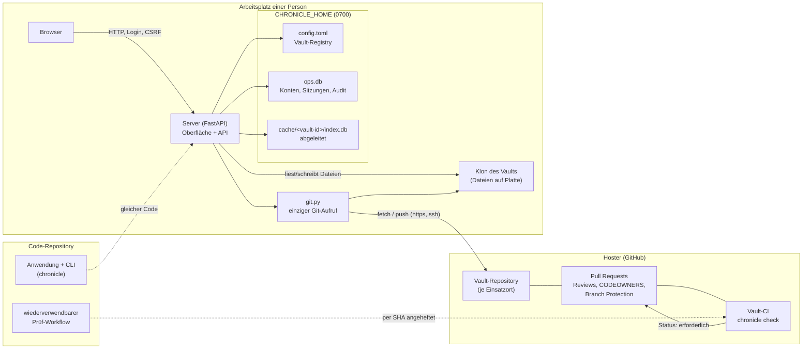
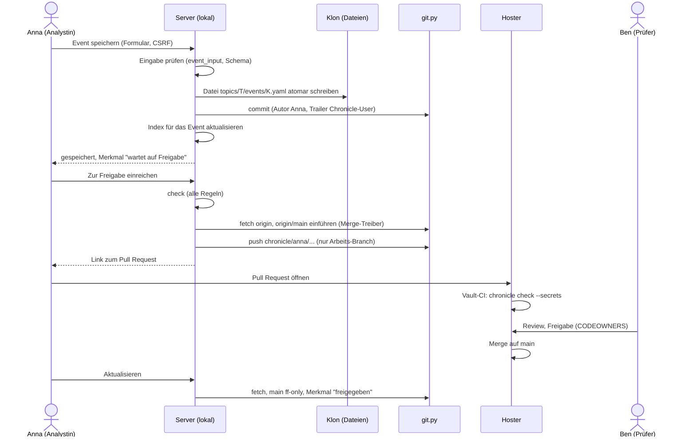
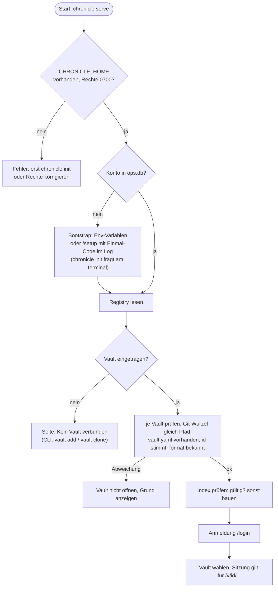
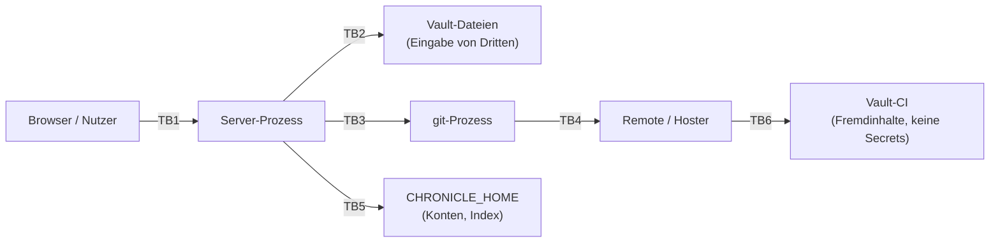

# Architektur: Chronicle mit Vault-Repositories in Git

- **Status:** Entwurf zur Prüfung (Sicherheit und Architektur), noch nicht umgesetzt
- **Stand:** 2026-10-25, Code auf `main` bei Commit `d68216f`
- **Entscheidungen:** ADR 0011 bis 0022 in [`docs/adr/`](../adr/). Umsetzungsplan: [`vault-git-plan.md`](vault-git-plan.md)

## 1. Ziel in einem Absatz

„As code“ heißt: in Git. Die **Programmlogik** liegt im Code-Repository. Die **Inhalte** (Topics, Events, Anhänge) eines Einsatzortes liegen in einem eigenen Git-Repository, dem **Vault**. Mehrere Personen arbeiten am Vault, prüfen ihre Änderungen gegenseitig per Pull Request und geben sie frei. Die Daten liegen als Dateien auf der Festplatte. Lokal bleiben nur ein Login (mit Bootstrap beim ersten Start) und die Verknüpfung zu den Vaults (Pfade), damit die Anwendung beim Start weiß, wo die Dateien liegen.

## 2. Ausgangslage (Ist-Zustand)

Vieles ist schon da. Das Konzept baut darauf auf und ändert wenig am Fundament:

| Baustein | Stand auf `main` | Datei |
|---|---|---|
| Dateien als Wahrheit, Index in SQLite | umgesetzt (ADR 0008, 0010) | `store.py`, `repository.py`, `db.py` |
| Datenordner als eigenes Git-Repository, Vorschau und Abgleich | umgesetzt | `sync.py` |
| Merge-Treiber auf Feldebene | umgesetzt, nur lokal wirksam | `merge.py` |
| Prüfung ohne Server, `check`, `plan`, `apply`, `build` | umgesetzt | `check.py`, `cli.py` |
| CI-Prüfung der Topic-Dateien | umgesetzt (`topic-files.yml`) | `.github/workflows/` |
| Konten, Sitzungen, Audit in eigener Datei | umgesetzt (ADR 0010) | `accounts.py`, `ops.db` |
| Zweiter Schreibpfad über die Datenbank | vorhanden, soll entfallen (#123) | `repository.py` |
| Anhänge in Git | bisher bewusst nicht (ADR 0008, 0009) | `evidence.py` |

Was fehlt: das Konzept „Vault“ als Einheit (Manifest, Registry), ein Layout, das Zusammenarbeit verträgt, ein Freigabe-Weg über Pull Requests, ein gehärteter Git-Aufruf, ein Umgang mit Identität, sensiblen Daten und Migration.

## 3. Komponenten

Zuständigkeiten:

- **Vault-Repository.** Nur Inhalte und das Manifest. Keine Konten, keine Geheimnisse, keine Datenbanken (ADR 0011, 0012, 0020).
- **Anwendung und CLI.** `chronicle` enthält Schema, Prüfung, Index, Rendering und den Server. Der Server enthält keine eigene Fachlogik (ADR 0009).
- **`git.py`.** Der einzige Ort, an dem `git` gestartet wird (ADR 0021).
- **`CHRONICLE_HOME`.** Alles Lokale, das nicht Inhalt ist: Registry, Konten, abgeleiteter Index (ADR 0013, 0017).
- **Hoster.** Rechte, Freigabe, Prüfungen. Er ist die Stelle, die die Freigabe erzwingt (ADR 0014, 0015).

## 4. Datenfluss

### 4.1 Ein Event anlegen und freigeben

### 4.2 Aktualisieren und Index

`Aktualisieren` holt `origin`, schiebt den lokalen Standard-Branch per `--ff-only` vor, führt ihn in den Arbeits-Branch ein und aktualisiert den Index über `git diff --name-status <indizierter Commit> HEAD` (ADR 0017). Ist der Index ungültig, wird er komplett aus den Dateien gebaut.

### 4.3 Lesen

Die Oberfläche liest ausschließlich aus dem Index. Anhänge liest der Server aus der Datei im Klon und vergleicht sie mit der Prüfsumme (ADR 0010, 0019).

## 5. Startsequenz

Eine Anmeldung erlaubt keinen Zugriff auf die Dateien. Sie erlaubt nur den Zugang zur Oberfläche und zur API. Wer die Dateien lesen kann, liest sie ohnehin (ADR 0013).

## 6. Git-Integration

Aufruf des Programms `git` in einem einzigen Modul (ADR 0021): Argumentliste statt Shell, feste Umgebung, `-c`-Schalter gegen Hooks, externe Protokolle und Submodule, `fsckObjects`, Zeitlimits, URL- und Branch-Prüfung, bereinigte Fehlermeldungen, Symlinks im Klon aus (`core.symlinks=false`). Die Anwendung ändert die Git-Konfiguration des Benutzers nicht und speichert keine Zugangsdaten. Authentifizierung gegenüber dem Hoster übernimmt Git (SSH-Agent, Credential Helper). Der Hoster-Zugang der App beschränkt sich auf `fetch` und `push` über Git, keine API, kein Token.

Verworfen: libgit2 und Dulwich (kein Merge-Treiber, eingeschränkte Authentifizierung und Signaturen), GitPython (Wrapper um dasselbe Programm mit mehr Angriffsfläche).

## 7. Vertrauensgrenzen

| Grenze | Was überschreitet sie | Schutz |
|---|---|---|
| TB1 Browser zu Server | HTTP, Formulare, Uploads | Login, Sitzungscookie (`HttpOnly`, `SameSite=Strict`), CSRF, Rollen, Drosselung (ADR 0001); neu: Vault-Kennung in jeder Anfrage (ADR 0018) |
| TB2 Server zu Vault-Dateien | YAML, Markdown, Anhänge von **anderen Personen** | strenge Prüfung vor dem Lesen: keine Links, Größen, kein YAML-Alias, keine doppelten Schlüssel, Bidi-Zeichen, Pfadregeln (ADR 0021); bereinigtes Markdown; Anhänge mit Sandbox-CSP |
| TB3 Server zu `git` | Argumente, Umgebung, Ausgabe | ein Modul, Muster für Branch und Key, `--`, feste `-c`, Zeitlimits (ADR 0021) |
| TB4 `git` zu Remote | Objekte, Zugangsdaten | https/ssh nur, `fsckObjects`, keine Zugangsdaten in URLs, Zugangsdaten bei Git/SSH-Agent, nicht in der App |
| TB5 Server zu Zustandsordner | Hashes, Sitzungen, Registry | Rechte `0700`/`0600`, Registry mit Vault-`id`, kein Geheimnis im Vault |
| TB6 Remote zu CI | Pull-Request-Inhalte (auch aus Forks) | `pull_request`, nur Lesen, keine Secrets, SHA-angeheftete Aktionen und Workflows (ADR 0021) |

## 8. Bedrohungsmodell (STRIDE-light)

| # | Bedrohung | Kategorie | Maßnahme | Rest |
|---|---|---|---|---|
| T1 | Eine Person ändert Dateien lokal und umgeht damit die App-Rollen | Elevation | Rollen sind nur Oberfläche. Entscheidend ist der Hoster: Schutz des Standard-Branches, Pull Request, Freigabe (ADR 0014, 0015) | Wer Schreibrechte auf dem Hoster hat, kann Vorschläge machen. Prüfer müssen prüfen |
| T2 | Commit unter fremdem Namen | Spoofing | Pull-Request-Autor ist der Hoster-Account. Signierte Commits optional bis Pflicht (ADR 0014) | Ohne Signatur sind Name und Adresse Eigenangaben |
| T3 | Kompromittiertes Konto schleust Inhalte ein (bösartiges YAML, Link auf `~/.ssh`, riesige Datei) | Tampering, Info Disclosure, DoS | Prüfung vor dem Lesen (ADR 0021, Punkte 11 bis 15), Vault-CI mit denselben Regeln | Neue Angriffsarten in YAML-Bibliothek oder Markdown-Bereinigung |
| T4 | Täuschung im Review: doppelter Schlüssel, Bidi-Zeichen, Unicode-Gleichaussehende in Keys | Spoofing der Prüfung | Strikter Lader, Zeichenregeln, Keys nur ASCII-Muster (ADR 0021, 0012) | Gleich aussehende ASCII-Keys (`l` und `1`) |
| T5 | Befehlseinschleusung über URL, Branch-Name oder Pfad beim Aufruf von Git | Tampering | Argumentliste, `--`, feste Muster, `protocol.ext.allow=never`, URL-Regeln (ADR 0021) | Fehler in Git selbst: Mindestversion, Updates |
| T6 | Bösartiger Klon (Hooks, Submodule, Filter, Attribute) | Elevation | Hooks aus Vorlage nicht geklont, `core.hooksPath` leer, Submodule aus, Treiber nur aus lokaler Konfiguration (ADR 0021, 17) | Git-Schwachstellen im Checkout (Mindestversion, `fsckObjects`) |
| T7 | Geheimnis oder personenbezogene Daten in der Historie | Info Disclosure | Muster-Prüfung, Hoster-Scanning, privater Vault, Verfahren zur Bereinigung (ADR 0020) | Kopien bleiben (Forks, Klone, PR-Referenzen) |
| T8 | Verwechslung von Mandanten (Schreiben in den falschen Vault) | Tampering, Info Disclosure | Genau ein aktiver Vault, `id` in Registry und in jeder Anfrage, Tests (ADR 0018) | Fehler im Code, der Pfade zusammensetzt |
| T9 | Ersetzter Vault-Ordner (anderer Inhalt unter bekanntem Pfad) | Spoofing | Vergleich der `id` aus `vault.yaml` beim Start (ADR 0013) | Wer den Ordner kontrolliert, kontrolliert die Daten (Betriebssystemrechte) |
| T10 | Diebstahl von `ops.db` (Hashes, Sitzungen) | Info Disclosure | Rechte `0700`/`0600`, Argon2id, nur Hash der Sitzungstokens (ADR 0001, 0013) | Offline-Angriff auf schwache Passwörter (Mindestlänge 12) |
| T11 | Laptop-Verlust: alle Vaults im Klartext auf Platte | Info Disclosure | Festplattenverschlüsselung ist **Voraussetzung** (Betriebsregel, nicht Teil der App) | Betrifft den Betrieb |
| T12 | Anhang mit aktiven Inhalten (SVG, HTML, PDF mit Skript) | Elevation (XSS) | Typ- und Signaturprüfung, SVG/HTML verboten, `sandbox`-CSP, `nosniff`, Download für Nicht-Bilder (ADR 0004) | PDF-Reader des Nutzers |
| T13 | Pull Request aus Fork führt CI mit Secrets aus | Elevation | `pull_request`, keine Secrets, `contents: read`, SHA-Pins (ADR 0021, 18) | Fehlkonfiguration im Vault |
| T14 | Streit über Verlauf: jemand löscht oder verändert Historie | Repudiation | Force-Push verboten, Administratoren eingeschlossen; Review-Verlauf beim Hoster; Audit der App als Ergänzung (ADR 0014, 0015) | Ein Hoster-Administrator kann Regeln ändern |
| T15 | Race: zwei Schreiber im selben Ordner (App und Editor) | Tampering | Dateisperre, Versionsvergleich (SHA-256 der Datei) vor dem Schreiben, atomares Schreiben (ADR 0008; `store.py`) | Externe Editoren ohne Sperre |
| T16 | Abfluss über Fehlermeldungen oder Logs (Tokens in URLs) | Info Disclosure | Keine Zugangsdaten in URLs, Bereinigung der Meldungen (ADR 0021, 6, 10) | — |

Nicht Teil dieses Modells: Angriffe auf das Betriebssystem des Arbeitsplatzes, Schwachstellen in Browser und Hoster, Insider mit Administratorrechten auf dem Hoster.

## 9. Fehlerfälle

| Fall | Verhalten |
|---|---|
| Git ist nicht installiert oder zu alt | Server startet, zeigt Hinweis, Schreiben und Abgleich gesperrt, Lesen aus dem Index möglich |
| Remote nicht erreichbar | `fetch`/`push` melden Zeitüberschreitung, lokal bleibt alles erhalten, Einreichen lässt sich später wiederholen |
| `push` abgewiesen (Branch Protection, keine Rechte) | Meldung des Hosters (bereinigt) wird gezeigt, Arbeits-Branch bleibt lokal |
| Konflikt beim Einführen von `origin/main` | Merge wird abgebrochen, Dateien werden genannt, Auflösung in der Oberfläche (Plan Teil 15) oder im Terminal |
| Merge-Ergebnis besteht `check` nicht | Zurücksetzen auf den Stand vor dem Merge, Probleme werden angezeigt |
| Vault-Ordner fehlt, `id` stimmt nicht, `format` unbekannt | Vault wird nicht geöffnet, andere Vaults bleiben nutzbar |
| Index fehlt oder ist beschädigt | Neuaufbau aus den Dateien, kein Datenverlust |
| Datei wurde außerhalb der App geändert | Versionskonflikt beim Speichern (409), Hinweis auf Aktualisieren |
| Zwei Instanzen auf demselben Klon | Dateisperre; wer sie nicht bekommt, bekommt einen Fehler statt Datenverlust |
| Anhang fehlt oder Prüfsumme stimmt nicht | Anzeige mit Warnung, Lieferung verweigert (Konflikt), `check` schlägt fehl |
| Angriffsmuster in Inhalten (Link, Alias, Bidi) | Datei wird abgelehnt, Vault bleibt mit dem letzten gültigen Index lesbar, Fehler mit Dateiname |
| Pull Request wurde auf dem Hoster verworfen | Arbeits-Branch bleibt lokal. Die Änderungen sind weiter sichtbar („wartet auf Freigabe“), bis sie verworfen werden |

## 10. Bewusste Grenzen

- **Kein Zugriffsschutz auf Dateiebene durch die App.** Vertraulichkeit entsteht durch Hoster-Rechte, Festplattenverschlüsselung und Betriebssystem (ADR 0013).
- **Kein Server-Modus für Teams im ersten Ausbau** (ADR 0014). Jede Person arbeitet mit eigenem Klon.
- **Keine Pull-Request-Anlage über die API** im ersten Ausbau (ADR 0015). Link statt Token.
- **Kein Windows.** `fcntl`-Sperre, Dateirechte (ADR 0013).
- **Keine Verweise zwischen Vaults** (ADR 0018).
- **Historie lässt sich nicht verlässlich aus allen Kopien tilgen** (ADR 0020).
